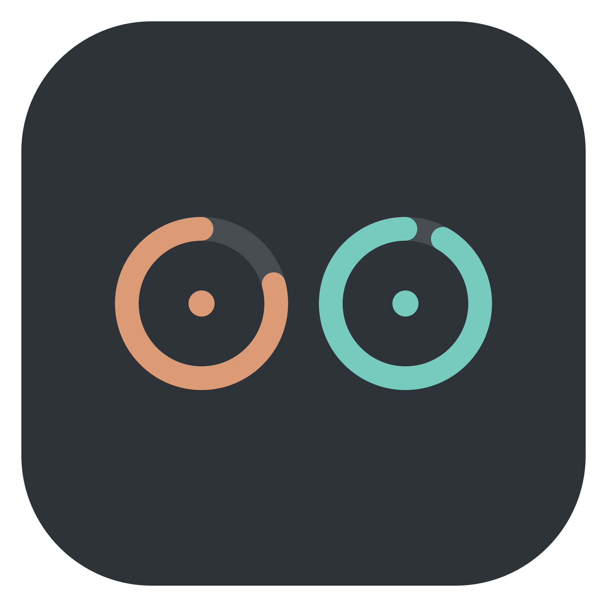
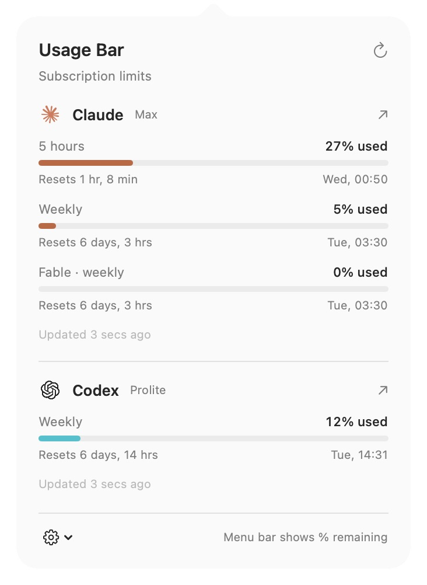
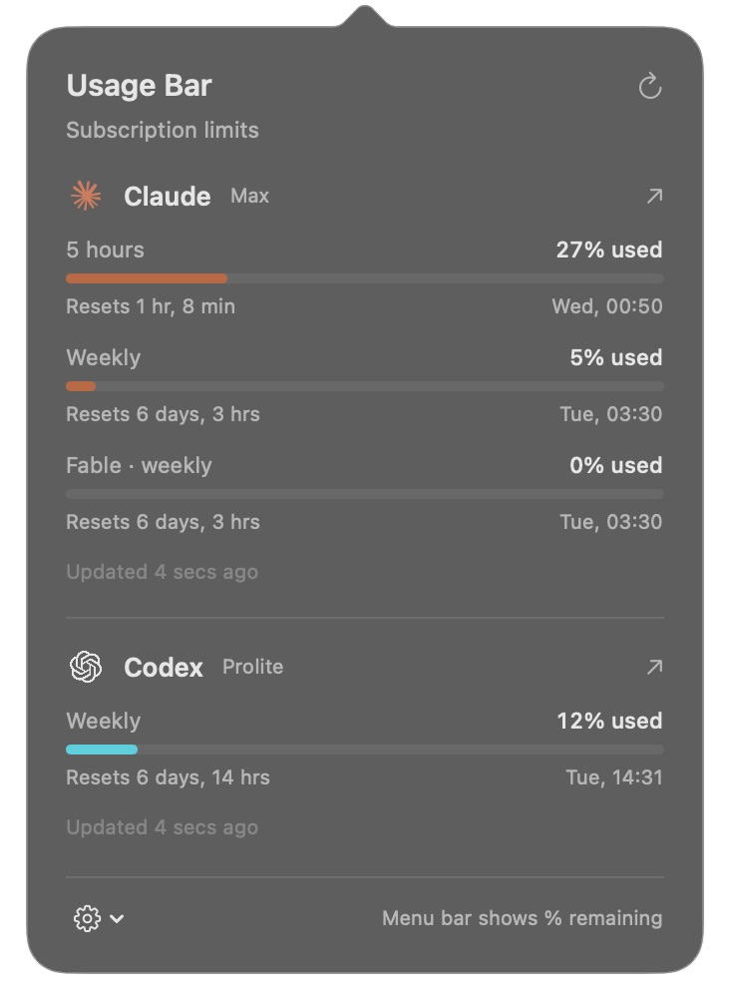

<p align="center">
  
</p>

<h1 align="center">Usage Bar</h1>

<p align="center">Claude and Codex subscription limits in your macOS menu bar.</p>

<p align="center">
  <a href="https://github.com/netchampfaris/claude-codex-usage-bar/actions/workflows/ci.yml"></a>
  
  <a href="LICENSE"></a>
</p>

Check your remaining limits without opening either CLI or usage dashboard.
The menu bar shows the lowest remaining percentage for each subscription, such as `C 74% · X 89%`.
Click it to see the individual usage windows and their reset times.

<table>
  <tr>
    <th>Light</th>
    <th>Dark</th>
  </tr>
  <tr>
    <td></td>
    <td></td>
  </tr>
</table>

Screenshots show a live snapshot. The available windows and percentages vary by account and plan.

## Features

- Reuses your Claude Code and Codex CLI sign-ins.
- Shows session, weekly, and scoped model limits when reported by the service.
- Displays reset countdowns and dates in your local time zone.
- Refreshes every five minutes, with a manual refresh button.
- Honors rate-limit backoff and labels earlier readings during errors.
- Links directly to each service's usage dashboard.
- Supports launch at login, light and dark appearance, and native accessibility labels.
- Runs locally with no third-party dependencies, telemetry, or server.

## Install

Requires macOS 14 or later and Swift 6.2 or later to build.
Xcode 26.2 includes a suitable Swift toolchain. Check yours with `swift --version`.

Sign in with the [Claude Code CLI](https://code.claude.com/docs/en/quickstart) and [Codex CLI](https://developers.openai.com/codex/cli/):

```sh
claude auth login
codex login
```

Clone this repository and install:

```sh
git clone https://github.com/netchampfaris/claude-codex-usage-bar.git
cd claude-codex-usage-bar
./scripts/install.sh
```

The script builds and signs the app locally, installs it in `~/Applications`, and opens it.
It appears in the menu bar and has no Dock icon.
Use the gear menu to enable **Launch at login** or quit.
Quit the app before installing an update.

To build without installing:

```sh
./scripts/build.sh
open "build/Usage Bar.app"
```

## How to read the limits

The menu bar shows **remaining** percentages. The popover shows **used** percentages for each window.
If Claude has used 26% of its session allowance and 5% of its weekly allowance, the menu bar shows `C 74%`.
It selects the lowest remaining percentage across the reported windows, including scoped limits.

The app uses the windows returned by the service. It does not assume that every plan has a five-hour limit.
Missing windows are omitted. Usage stays at the last reported value until the service confirms a reset.

## Sign-ins and privacy

| Service | Credential source |
| --- | --- |
| Claude | `~/.claude/.credentials.json`, when present, or the `Claude Code-credentials` Keychain item |
| Codex | `~/.codex/auth.json` with a ChatGPT subscription sign-in |

The app reads credentials without changing them or saving another copy.
It sends authenticated, read-only requests to the services' usage endpoints:

- `https://api.anthropic.com/api/oauth/usage`
- `https://chatgpt.com/backend-api/wham/usage`

Credentials and responses stay in memory. The network session has no persistent cache or cookies, and redirects are rejected.
There is no browser-cookie access, API billing integration, or automatic token refresh.

These subscription endpoints are not stable public APIs for third-party apps. They can change.
An unfamiliar response produces an error instead of an invented usage value.

`CLAUDE_CONFIG_DIR` and `CODEX_HOME` are respected when set in the app process environment.
Apps opened from Finder usually do not inherit environment variables from your shell.
Codex Keychain-only credential storage is not supported.

## Troubleshooting

| Symptom | What to do |
| --- | --- |
| Usage is unavailable | Sign in through the appropriate CLI, then refresh. The app can copy the sign-in command for you. |
| Sign-in has expired | Run `claude auth login` or `codex login` again, then refresh. |
| Claude credentials cannot be read | Check that Claude Code is signed in and allow its credential read if macOS prompts. |
| Too many usage requests | Wait for the next refresh time shown in the app. Manual refresh respects the same backoff. |
| An earlier reading is shown | Check your connection or the service status, then refresh. |
| Launch at login needs approval | Allow Usage Bar in System Settings → General → Login Items. |

For a live check without opening the popover:

```sh
"build/Usage Bar.app/Contents/MacOS/UsageBar" --check
```

`--check` prints percentages and reset times. It exits with a nonzero status if either service cannot be read.
It never prints credentials or account identifiers.

## Development

```sh
swift test
./scripts/build.sh
```

The tests cover both usage formats, scoped limits, changing window durations, malformed responses, and rate-limit backoff.
GitHub Actions runs the tests and verifies the release app bundle on macOS without subscription credentials.

See [CONTRIBUTING.md](CONTRIBUTING.md) for development and screenshot instructions.

## License and attribution

The code is licensed under [MIT](LICENSE).
Provider names and logos belong to their respective owners and are excluded from that license.
See [NOTICE.md](NOTICE.md) and the [logo source notes](Resources/BrandSources/README.md).

Usage Bar is an independent project, unaffiliated with Anthropic or OpenAI.

Usage references: [Codex documentation](https://learn.chatgpt.com/docs/pricing),
[OpenAI's usage client](https://github.com/openai/codex/blob/main/codex-rs/backend-client/src/client/rate_limit_resets.rs),
and [Anthropic's usage endpoint tracker](https://github.com/anthropics/claude-code/issues/31637).
